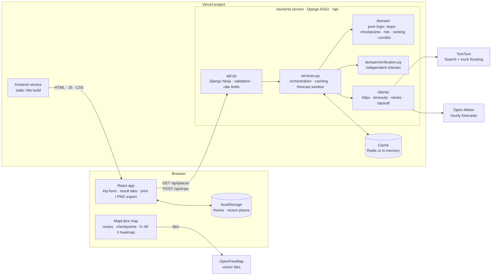
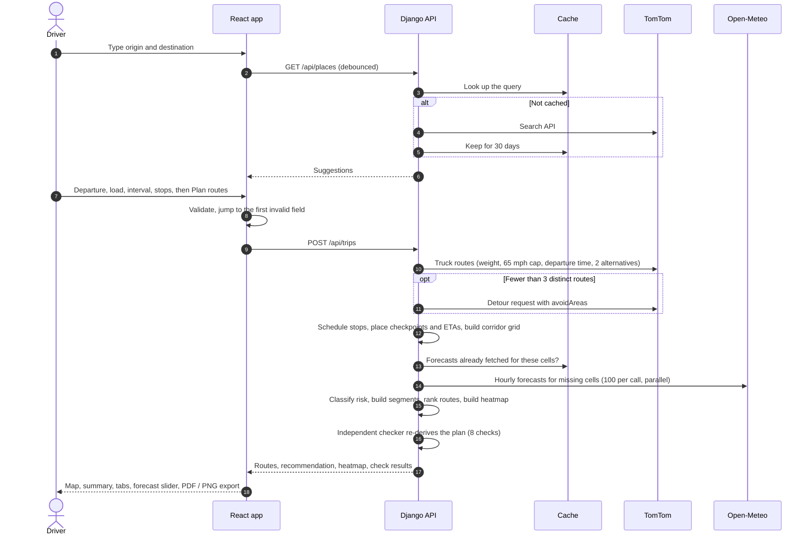

# Weather-Aware Truck Routing

A React + Django app that helps a truck driver choose the safest route. It compares up to three truck routes, samples the forecast at each checkpoint for the time the truck is expected to arrive there, classifies risk using the provided weather and load rules, and recommends the safest option. Routes, checkpoints and a 0–48 hour weather heatmap of the trip corridor are shown on a map.

## Features

- **Three truck route options** from TomTom's truck routing (commercial vehicle with gross weight, traffic-aware departure time). If TomTom returns fewer than three distinct routes, the app asks for one more route that avoids a box around the middle of each route already found (TomTom `avoidAreas`). This finds a genuinely different corridor without adding stops or backtracking. Near-duplicates are dropped, so if only one or two practical roads exist, the app shows only those.
- **Arrival-time weather sampling** every 10, 25 or 50 miles, including the destination. Each checkpoint's ETA comes from TomTom's per-point travel time, plus optional hours-of-service stops.
- **Risk classification** using the wind, rain and snow table and the load rules, with the condition that drove each level shown in the UI.
- **Recommendation** ranks routes strictly in the order the brief specifies and explains the deciding factor against the runner-up.
- **Map:** each route is colored by risk per segment; checkpoints show their full readings; rest and break stops are marked; clicking a route selects it.
- **Corridor heatmap** with a 0–48 h slider (hours from departure), play/pause, and risk, wind, rain or snow layers.
- **Independent rule checker.** A separate module re-derives every number in the finished plan without calling the planner's code: risk bands and load rules, checkpoint spacing, ETAs, stretch levels, mileage, average risk, hours-of-service stops and the recommendation order. The result ships with every plan and shows as "8/8 checks passed".
- **Trip summary and result tabs:** Routes, Itinerary (every departure, driving leg, weather alert, break, rest and arrival, grouped by day), Checkpoints and Checks. Itinerary and checkpoint items fly the map to that point.
- **Export:** Print / save as PDF produces a report with a map snapshot, the route comparison, itinerary, checkpoint table and checks. PNG export saves the map with a title band and risk legend.
- **Convenience:** recently used places (stored in the browser), a light/dark theme that follows the system until changed, a form that folds away after planning and jumps to the first invalid field, and collapsible panel and forecast cards. The layout works down to phone width.

## Quick start

Requirements: Python 3.13 with [uv](https://docs.astral.sh/uv/), Node 22+, and a free [TomTom API key](https://developer.tomtom.com/) with the **Routing API** and **Search API** enabled.

```bash
# Backend
cd backend
cp .env.example .env            # then set TOMTOM_API_KEY
uv sync
uv run uvicorn config.asgi:application --port 8000

# Frontend (second terminal)
cd frontend
npm install
npm run dev                     # http://localhost:5173, proxies /api to :8000
```

Interactive API docs: `http://localhost:8000/api/docs`.

### Checks

```bash
cd backend && DJANGO_DEBUG=true uv run pytest && uv run ruff check . && DJANGO_DEBUG=true uv run mypy .
cd frontend && npm test && npm run lint && npm run build
```

### Deploying to Vercel

`vercel.json` deploys both halves as one Vercel project using [Vercel Services](https://vercel.com/docs/services) (beta, available on all plans). The Vite frontend is served as static files, and every `/api/*` request goes to the Django ASGI app, on the same domain. No CORS setup or API URL variable is needed.

1. Push the repository to GitHub and import it in Vercel. Keep the **Root Directory** at the repository root, where `vercel.json` lives.
2. Add the environment variables below under *Settings → Environment Variables*.
3. Deploy. The frontend installs with `npm ci` and builds with `npm run build`. The backend installs from `backend/pyproject.toml` and `uv.lock` on Python 3.13 (`backend/.python-version`).

`vercel dev` runs both services locally the same way.

| Variable | Purpose |
| --- | --- |
| `TOMTOM_API_KEY` | Required. Routing and place search. |
| `DJANGO_SECRET_KEY` | Required. Any long random string. |
| `REDIS_URL` | Recommended. A Redis URL (for example Upstash from the Vercel Marketplace). Function instances then share the route, weather and place cache and the per-IP rate limits. Without it, each instance keeps its own short-lived memory cache. |
| `DJANGO_ALLOWED_HOSTS` | Only for custom domains. The deployment's own `*.vercel.app` hosts are allowed automatically. |
| `NUM_PROXIES` | Proxies in front of the app, used for per-IP rate limiting. Defaults to 1 on Vercel and 0 locally. |
| `OPEN_METEO_URL`, `OPEN_METEO_API_KEY` | Optional. A commercial Open-Meteo endpoint with higher limits. |

## Architecture



```
backend/
  planner/domain/      Pure, fully unit-tested logic (no I/O)
    risk.py              Risk table + load rules
    geo.py               Route geometry, interpolation, simplification
    sampling.py          Checkpoints and ETAs along a route
    hours_of_service.py  30 min break / 10 h rest scheduling
    weather.py           Hourly series lookup at an arbitrary time
    assessment.py        Segments, mile-weighted risk summary
    recommendation.py    Route ranking + deciding factor
    corridor.py          Heatmap grid around the routes
    alternatives.py      Route de-duplication and detour boxes
    verification.py      Independent checker for a finished plan
  planner/clients/     TomTom and Open-Meteo HTTP clients (timeouts, retries, backoff)
  planner/services.py  Orchestration, caching, forecast window
  planner/api.py       Django Ninja endpoints: GET /api/places, POST /api/trips
frontend/src/
  api/                 Typed client + TanStack Query hooks
  hooks/               Theme, export, debounce, map-coverage hooks
  lib/                 Pure helpers (risk colors, heatmap, itinerary, export, recent places)
  components/          Form, summary, result tabs, itinerary, map, forecast panel, print report
```

### Planning workflow



### How one trip plan is built

1. Fetch the truck routes from TomTom. Gross weight = load + 35,000 lb typical tractor-trailer tare, and top speed is capped at 65 mph (105 km/h), a common fleet limit. Without the cap TomTom assumes trucks drive the posted limit (up to 75–80 mph), which makes ETAs, and therefore the forecast hour read at each checkpoint, too early.
2. For each route, schedule hours-of-service stops if enabled, then place checkpoints at every interval and at the destination. Each checkpoint's ETA is departure + driving time + completed stops.
3. Build a corridor grid within 25 miles of all routes. Its cell size grows (0.1° up to 2°) to keep the grid at 200 cells or fewer; checkpoints use the finest grid (from 0.1°) that needs 250 lookups or fewer.
4. Fetch hourly forecasts once per unique grid cell for the whole trip window, at least departure + 48 h. Calls are batched 100 locations per request, run in parallel, and cached for 1 hour.
5. Classify every checkpoint and every heatmap cell for each hour, then rank the routes.
6. Run the independent checker over the finished plan and attach its results.

CPU-heavy steps run in a worker thread so the async event loop stays responsive.

**Caching:** place searches 30 days on the server and 1 day in the browser (`Cache-Control`), routes 1 hour per origin, destination, departure and weight, forecasts 1 hour per grid cell and time window.

## Risk rules: interpretation

| Condition | Low | Moderate | High | Severe | No travel |
| --- | --- | --- | --- | --- | --- |
| Wind (mph) | < 25 | 25 – < 35 | 35 – < 45 | 45 – < 55 | ≥ 55 |
| Rain (in/hr) | < 0.10 | 0.10 – < 0.25 | 0.25 – < 0.50 | 0.50 – 1.00 | > 1.00 |
| Snow (in/hr) | < 0.5 | 0.5 – < 1.0 | 1.0 – < 2.0 | 2.0 – 3.0 | > 3.0 |

- **Shared boundaries** go to the higher band (e.g. exactly 35 mph is High). The No-travel boundaries follow the table literally: ≥ 55 mph, but > 1.00 in/hr rain and > 3.0 in/hr snow.
- **Load rules** apply to the wind level: 45–54 mph with more than 30,000 lb becomes No travel, and 35–44 mph with more than 40,000 lb becomes Severe. The UI flags when a load raised the level.
- **A checkpoint's level** is the worst of wind, rain and snow.
- **Wind** uses sustained 10 m wind speed; gusts are shown but don't change the level.
- **Rain** is Open-Meteo `rain + showers`, because Open-Meteo reports large-scale and convective rain separately. Snow is `snowfall` in inches.
- **Timing:** wind is interpolated linearly between hours. Rain and snow are hourly totals, so the hour containing the ETA is used.
- **Missing forecast values** fail the request with a clear message. They are never treated as Low.

## Recommendation

Each stretch between two checkpoints takes the **worse** of its two levels, so every mile is counted. Routes are then compared lexicographically:

1. Fewest **no-travel** miles. This is added in front of the brief's list, since no-travel is worse than severe.
2. Fewest **severe** miles
3. Fewest **high** miles
4. Lowest **average risk**, weighted by miles (Low 0 … No travel 4)
5. Shortest **travel time**, including stops

Values are rounded (0.1 mi, 0.001 risk, 1 min) before comparing, so floating-point noise can't decide a tie. If even the best route has no-travel miles, the UI suggests delaying departure.

## Assumptions and limitations

- **Hours of service** (toggle, on by default): a 30-minute break after 8 h of driving and a 10-hour rest after 11 h. The 14-hour window and 70-hour/8-day limits are not modelled, and the driver is assumed to start fresh. Weather during a stop doesn't count toward risk.
- **Departure** must be within the next 14 days, and arrival must fall inside Open-Meteo's 16-day forecast. The heatmap slider covers departure + 0–48 h.
- **Load weight** is cargo weight (1–80,000 lb). The load rules use it as entered.
- **Times** are shown in the browser's time zone.
- **Free-tier limits:** Open-Meteo allows 10,000 location-calls a day, and one plan uses at most 200 heatmap cells plus 250 checkpoint cells (both grids coarsen automatically on long trips). Without `REDIS_URL` results are cached per process or function instance. For heavier use, set `OPEN_METEO_URL` / `OPEN_METEO_API_KEY` to a commercial plan and set `REDIS_URL`.
